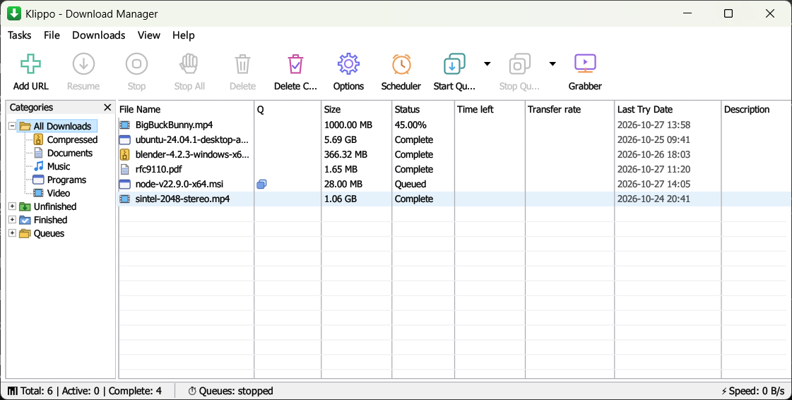
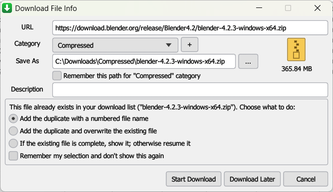
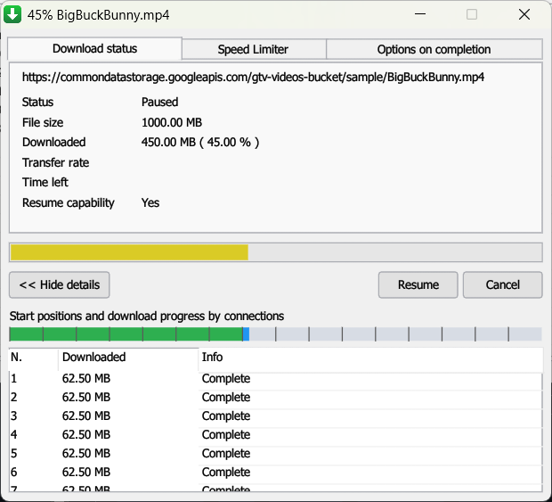
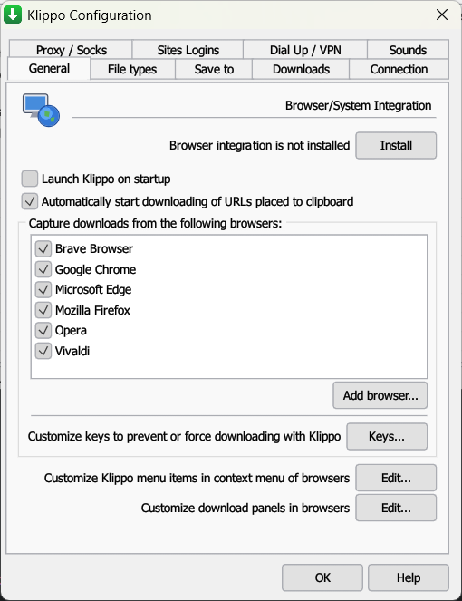
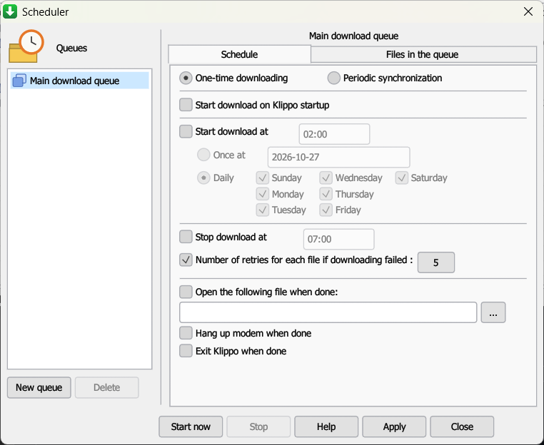
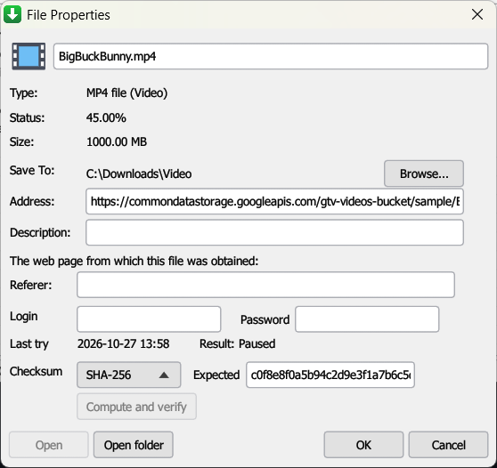
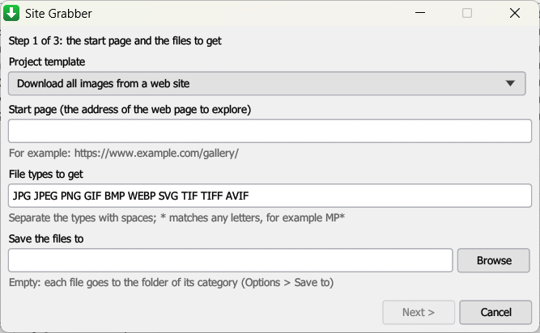

# Klippo (Rust)

A multi-connection download manager for Windows, written in Rust. It pairs a
classic Windows interface with deep browser integration, queues, a scheduler,
a speed limiter and command-line switches.

Klippo is an independent, free project.



## Screenshots

<table>
  <tr>
    <td align="center"><b>Download File Info</b><br></td>
    <td align="center"><b>Download progress</b><br></td>
  </tr>
  <tr>
    <td align="center"><b>Options</b><br></td>
    <td align="center"><b>Scheduler and queues</b><br></td>
  </tr>
  <tr>
    <td align="center"><b>File properties and checksum</b><br></td>
    <td align="center"><b>Site Grabber</b><br></td>
  </tr>
</table>

---

## Features

### Download engine
- Up to **32 connections per file**. Small files use fewer parts; when a
  connection finishes early it takes half of the largest remaining part
  (dynamic segmentation).
- **Pause / resume** that keeps progress: segment state is saved atomically
  every second and on stop (`<file>.klippo.state`). Workers are awaited
  before the file closes, so the saved state always matches the bytes on disk.
- **Automatic retries** with back-off for timeouts, cut connections, HTTP 5xx,
  408 and 429, also for the first request of a download (a busy server that
  answers 503 at the start). HTTP 4xx errors (404, 403, ...) fail at once with
  a clear message.
- Response checks: a part is only written when the server answers with the
  requested byte range.
- Works with servers **without range support** (one stream, restarts after a
  cut) and with **unknown sizes** (chunked / close-delimited responses).
- The file name comes from `Content-Disposition` (including RFC 5987
  `filename*`), then the redirected URL, then the MIME type. Names are
  sanitized against path traversal and Windows-reserved names.
- If the remote file changed (size or ETag; optionally Last-Modified) the
  download restarts instead of mixing two versions.
- **Drag a link** from the browser onto the window to download it.
- **Checksum verify** after a download: CRC32, MD5, SHA-1 or SHA-256, checked
  against an expected value in File Properties.
- **Speed limiter**: one shared limit for all downloads, plus a per-file limit
  from the progress window. Both change while the download runs. "Remember
  the speed limit for this server" gives new downloads from that server the
  same limit; turning the limiter off forgets the server.
- **Proxies**: HTTP / HTTPS proxies with authentication and a bypass list,
  **SOCKS5** (host names resolved by the proxy), Windows system settings, and
  **PAC scripts** ("Use automatic configuration script", resolved per address
  with WinHTTP). A download taken from the browser can retry through the
  browser's own proxy after an error.
- **Site logins** (basic auth per host, address prefix or `*.pattern`),
  cookies, referrer and user agent from the browser.
- **FTP** (`ftp://` links, `core/ftp.rs`): passive or active mode (Options >
  Proxy / Socks > "Use FTP in PASV mode"), logins from the address, "Use
  authorization" or Site Logins, resume with `REST`, and SOCKS5 for the
  control and data connections. Every address of the server is tried in
  turn (an IPv6 address that the network does not route falls back to IPv4).
- **Temporary directory** (Options > Save to): the parts of video streams
  are kept there until they are joined (`core/parts.rs`).
- **Dial Up / VPN**: connects the chosen Windows dial-up or VPN entry before
  downloads start (`rasdial`), with redial attempts and the time between them.
  The connection list comes from Windows (`RasEnumEntries`), the same list
  that `rasdial` uses.
- **HLS / M3U8 grabber**: picks the best variant of a master playlist,
  supports `#EXT-X-MAP` and `#EXT-X-BYTERANGE`, downloads parts in parallel,
  resumes by part and joins them into one file. AES-128 streams are
  decrypted. Live playlists (no `#EXT-X-ENDLIST`) are refused with a message:
  Klippo does not record live streams. DRM streams (SAMPLE-AES, FairPlay,
  Widevine) are rejected with a message.
- **Site Grabber** (`core/site_grabber.rs`, the Grabber button or Tasks > Run
  site grabber): a project template (images, audio, video, documents,
  archives, all files, or your own file types) and a start page, then how far
  to explore: link levels, only the start page's server or folder, files from
  other servers, a page limit and a login. The pages are read one after the
  other; the files found are listed with check boxes and go to a queue, each
  with the page that links to it as the Referer.

### Window (egui)
- A classic Windows look: menu bar (Tasks, File, Downloads, View, Help), the
  large toolbar with two-color line icons (drawn by Klippo, `gui/icons.rs`),
  the "Categories" tree (All Downloads, Unfinished and Finished with their
  categories, Queues) with [+] boxes and guide lines, and the list columns
  (File Name, Q, Size, Status, Time left, Transfer rate, Last Try Date,
  Description) with grid lines down to the bottom of the list. The window is
  light or dark as Windows apps are (View > Follow Windows theme), the title
  bar follows that look, and there is no status bar until you ask (View >
  Status bar). Fonts are Tahoma 8 pt for the windows and Segoe UI 9 pt for
  menus and titles, with no bold text. Dialogs are measured in Windows dialog
  units (at 125 % one unit is 1.4 pixels across and 1.6 down); buttons are
  50 x 14 units (70 x 22.4). The main window opens at 895 x 423 inside its
  frame.
- The toolbar buttons, the Categories tree, the list rows and the combo boxes
  (named after their labels, with the shown choice as value) have names for
  screen readers and Windows UI Automation.
- Every dialog is a **window of its own**: it can be moved outside the main
  window and fits its contents. "Download File Info", the progress window,
  "Download complete" and "Download all links with Klippo" have a minimize
  button (the window waits on the taskbar); the other dialogs have none.
- The classic dialogs (`gui/views/classic_ui.rs` draws the shared parts):
  Options with two rows of tabs and nine pages, "Enter new address to
  download" then "Download File Info", the progress window with its three
  tabs, Download complete, Scheduler, Speed Limiter settings, Batch download
  with the queue panel, Find file (Ctrl+F, F3), Columns (View > Customize URL
  List...), File Properties, About, Site Grabber and "Add new category". For
  screenshots and checks, `KLIPPO_SHOW=options:3` (or scheduler, dfi,
  progress, sitegrabber, ...) opens one window at start.
- **Your own categories**: "Add new category" (Options > Save to > New, the
  "+" in Download File Info, or the Categories tree's menu: right-click, or
  Shift+F10 on the selected item) takes a name, file types and a folder. A new
  category comes before the fixed ones when a file type is in both. Delete
  removes it (Save to > Delete, or the tree's menu); its files go back to the
  category of their type. The tree's menu also opens Properties (Options >
  Save to for that category).
- Table: resizable columns, click a header to sort, Ctrl/Shift multi-select,
  right-click menu, double-click to open or show progress, Delete key,
  Ctrl+A, Ctrl+C (copy links), Enter.
- **Enter new address** dialog checks the address while you type and shows
  the size, the server's file name and resume capability (the "Download File
  Info" dialog). Duplicate links are flagged and saved with a numbered name.
- **Download progress** window per download: status grid, progress bar,
  per-connection map and table, per-file speed limiter, Pause / Resume / Cancel.
- **Download complete** dialog: Open, Open with..., Open folder (file selected
  in Explorer), "Don't show this dialog again".
- **Options** (9 tabs, OK and Help; the close box cancels and really
  reverts): General, File types, Save to, Downloads, Connection, Proxy /
  Socks, Site Logins, Dial Up / VPN, Sounds. The sub-dialogs work too:
  "Using special keys", the browser context-menu items, advanced proxy
  settings (HTTPS proxy, exceptions, SOCKS), file types per category,
  addresses not to capture, progress-dialog and virus-check settings.
- "Start downloading immediately while displaying Download File Info": a
  file from the browser or the clipboard starts at once; Cancel removes it,
  and a new name or folder chosen in the dialog is applied when it is done.
- **Queues and Scheduler**: the Main download queue plus your own queues (New
  queue / Delete). Each queue has its own schedule: start once on a date,
  daily or on chosen days, "start again every" N hours/minutes (periodic
  synchronization), stop time, start on Klippo startup, files at the same
  time, retries for failed files, reorder; when done: stop the queue, open
  a file, hang up, or exit. (Klippo does not turn the computer off.)
  "Download Later" lets you pick the queue.
- **Duplicate download link**: add with a numbered name, overwrite the
  existing file, or show/resume the existing download; "remember my selection".
- **Connecting to the site**: an HTTP 401 opens a login prompt with the
  server's realm; the login can be saved to Site Logins.
- **Download limits**: "Download no more than N MB every M hours", with
  an optional warning before stopping.
- **Max. connections number for a server** exceptions with wildcards.
- **Proxy / Socks**: none, Windows system settings, automatic configuration
  script (PAC) or manual, with the protocols (http, https, ftp) that use it.
- **Export / import download-list files (.ef2)** with referrer, cookies and
  logins, or plain text lists; export the queue, the selection or everything.
- **Batch download**: pattern mode (`http://site/file*.zip`, numbers with
  zero padding or letters) or a list of addresses; "Add batch download from
  clipboard".
- **Properties**: rename or move to another folder with "Browse..." (also the
  partial data of a stopped download, also to another drive), change an
  expired address, description, and a checksum (CRC32 / MD5 / SHA-1 / SHA-256)
  computed in the background and checked against an expected value.
- **Clipboard monitor** that uses the File types list and ignores links that
  Klippo copies itself.
- Confirmation before deleting downloads (unfinished data is cleaned up;
  completed files are deleted only if you tick the box) and before exiting
  while downloads run.
- **Notification-area (tray) icon**: closing the window keeps Klippo running
  in the tray; left-click shows it, right-click opens Show / Add / Start queue /
  Stop queue / Speed Limiter / Exit. A balloon appears when a download finishes
  or fails while Klippo runs in the background.
- **A download from the browser shows only its dialog**: "Download File Info"
  (or "Download all links with Klippo", or the progress window when the dialog
  is turned off) comes in front of the browser and takes the keyboard, and the
  main window stays in the notification area or wherever it is. When Klippo is
  not running, the browser starts it in the notification area. The same goes
  for links from the clipboard and for `/d <address>`; starting Klippo without
  a download shows the main window.
- Sounds (Windows sounds or your own WAV files), virus scan after download,
  open file when done, start with Windows (registry Run key), dark mode.
- View menu: show/hide columns (Referer column available), large or small
  toolbar buttons, tray icon on/off, font size; Downloads menu: Pause All (only
  downloads that can resume), Stop All, Find (Ctrl+F) and Find next (F3).
- Speed Limiter "always turn on at startup", "Set file date as provided by the
  server", User-Agent for manually added downloads, "only add captured links
  to the queue".
- Progress window "<< Hide details".
- **Single instance**: a second launch (command line, browser) hands its
  request to the running window.
- Settings and the list are saved to `%APPDATA%\Klippo\`. New settings fields
  get defaults, so updating never resets your settings.

### Browser integration
- Native messaging host `org.klippo.downloader` for Chrome, Edge, Brave,
  Chromium-based browsers and Firefox.
- Extension in `extension/` (Chromium MV3 and Firefox): takes over the
  browser's downloads (sites in the exception list stay in the browser),
  sends cookies (of the private window for a private download), referrer and
  user agent, and adds **Download with Klippo** to the right-click menu. If
  Klippo cannot be reached, the browser keeps the download. See
  `extension/README.md`. The kinds of download it takes:
  - **every file type** ("Take browser downloads of all file types" in
    Options > File types, on by default); without it, only the types in the
    list. Web pages that the browser saves stay in the browser.
  - files named only by the server (`download.php?id=7` with
    Content-Disposition) and redirected addresses;
  - **forms that answer with a file** (POST): the extension keeps the form's
    fields, and Klippo sends the same POST again for the file;
  - **files that a page makes itself** (`blob:` and `data:` addresses), which
    no download manager can fetch: the browser saves them, then Klippo moves
    the file to the folder of its category and lists it as complete.
- **Special keys**: hold the "prevent" key (Alt by default) when you
  click a link to let the browser download it, or the "force" key (Ins by
  default; both are set in Options > General > Keys...) to give Klippo a
  link it would not take.
- Four **context-menu items**, each one switched on or off in Options >
  General > Edit...: Download with Klippo, Download last requested video,
  Download videos from 10 last requested, and **Download all links** (all
  links of the page, or the selected ones, go to the batch dialog).
- Captured downloads carry the browser's proxy, so Klippo can retry through
  it after an error (Options > Proxy / Socks).
- **Download this video** button over playing videos: it lists the
  direct files and HLS qualities the page loads (size, height, length) and
  sends the chosen one to the "Download File Info" dialog. The toolbar popup
  shows the same list.
- **Customize download panels in browsers** (Options > General > Edit...),
  two pages: the panel on web players (full or mini mode, the file
  types it shows for, a minimum size, sites without the panel, protected
  content, "Don't capture downloads from web-players automatically") and the
  **panel for selected links**: select text with links on a page and a
  "Download N links with Klippo" button sends them to the "Download all
  links" list (for any page, no page, or only the listed sites).
- **Separate audio**: HLS qualities with their own audio playlist,
  DASH manifests (`.mpd`) and split DASH-style files are downloaded together
  with their audio and joined into one file (`core/hls.rs`, `core/dash.rs`,
  `core/mp4mux.rs`, `core/ts.rs`). Every joined MP4 is a regular MP4 with
  full sample tables, so VLC plays the sound and seeks correctly. WebM
  streams (VP9 with Opus) are joined into one WebM with cues
  (`core/mkvmux.rs`).
- **YouTube**: the same button lists every quality (up to 4K: H.264 or AV1
  in MP4, VP9 in WebM where YouTube has nothing else) and audio only. Klippo
  replays the web player's own SABR stream request (with its
  proof-of-origin token), downloads the video and audio streams, and joins
  them into one MP4 (`core/youtube.rs`, `core/mp4mux.rs`). Pause and resume
  work. Live streams are not offered and not recorded. See
  `extension/README.md` for how it works.

---

## Build

```powershell
cd klippo
cargo build --release
```

The program is `target\release\klippo.exe` (no console window).

`vendor/eframe` and `vendor/egui` are eframe and egui 0.30.0 with small
accessibility patches (see their `KLIPPO-PATCH.md`): every dialog window gets
an accessibility tree, a click opens a submenu, and text boxes accept "set
value". Screen readers, voice control and Windows UI Automation can then use
every window, menu and field.

## Command line

Classic Windows-style switches and Unix-style flags both work.

```powershell
# Open the window (or bring the running one to the front)
klippo.exe

# Add a link (shows the "Enter new address" dialog)
klippo.exe /d "https://example.com/file.zip"

# Folder and file name; /n = start without asking
klippo.exe /d "https://example.com/file.zip" /p "D:\Downloads" /f "my.zip" /n

# /a = add to the main queue only, /s = start the queue, /q = exit when done
klippo.exe /d "https://example.com/a.iso" /a
klippo.exe /s

# Console download with live per-connection display (Ctrl+C stops; run again to resume)
klippo.exe --cli -d "https://example.com/large.iso" -c 16 -l 2M
klippo.exe --cli -d "https://example.com/stream/master.m3u8" -f video.ts --hls

# Extra request headers (also in window mode)
klippo.exe --cli -d URL --referer https://example.com/ --cookie "sid=1" --user-agent "..."

# Browser integration
klippo.exe install-host [--extension-id <id>]
klippo.exe uninstall-host
```

`-l` takes `2M` (MB/s), `500K` (KB/s) or a plain number (KB/s).

## Tests

```powershell
cargo test
```

For tests of the whole program, `KLIPPO_TEST_LOG=<file>` makes Klippo write
the actions that reach outside it (sounds, opening files and folders, hanging
up, dialing, a dialog taking the keyboard from another program) to that file
instead of doing them.

- `tests/integration_tests.rs`: segment math, direct storage writes, resume
  state, token bucket, 8-connection download with SHA-256 check, dynamic
  resegmentation.
- `tests/engine_edge_cases.rs`: tiny and empty files, unknown size, servers
  without ranges, retries after 503 and cut connections (also a busy server
  at the first request), 404 message,
  Content-Disposition naming, explicit name priority, pause + resume with
  state check, fresh start, changed remote file, live speed-limit change,
  shared global limiter, oversized chunks in the limiter, HLS end to end, a
  live HLS playlist refused before any segment is fetched.
- `tests/manager_bridge.rs`: the window's download supervisor without a
  window: live speed, pause, resume, delete, restart of the same item, probe,
  HLS.
- `tests/net_options.rs` (ignored by default; they need real servers): a
  download through a SOCKS5 proxy, a PAC script lookup, and an FTP download
  (optionally through SOCKS5). The file header shows the environment
  variables to set.
- Unit tests for header parsing, file names, wildcards, playlists, batch
  patterns, settings compatibility, capture rules, site logins, command-line
  switches and native-message framing.

## Project layout

```
src/
  main.rs                 command line, switches, --cli mode, native-host detection
  core/
    engine.rs             segmented HTTP engine (probe, workers, retries, resume)
    http.rs               client/proxy setup, Content-Disposition, file names, wildcards
    segment.rs            byte ranges and work-stealing split
    storage.rs            pre-allocated file with positional writes
    resume.rs             atomic .klippo.state files (older ones from earlier versions are renamed)
    rate_limiter.rs       token bucket (per file and shared)
    hls.rs                M3U8 grabber
    ftp.rs                FTP download (passive/active, REST resume, SOCKS5)
    parts.rs              temporary directory for stream parts
    dash.rs               DASH manifest (.mpd) reader: representations and segments
    ts.rs                 joins TS video with separate TS or packed AAC/AC-3/E-AC-3 audio
    youtube.rs            YouTube SABR stream download (UMP parts, resume)
    mkvmux.rs             joins WebM / Matroska streams (VP9, Opus) into one WebM with cues
    mp4mux.rs             joins MP4 streams (fragmented or not) into one regular MP4
    protobuf.rs           minimal protobuf reader/writer for SABR messages
    site_grabber.rs       Site Grabber: reads pages, follows links, collects files
  gui/
    mod.rs                main loop, shortcuts, tray, close handling, window icon
    state.rs              data model, settings, queue, scheduler, events, persistence
    manager.rs            download supervisor thread (start/stop/remove/probe/hash)
    ipc.rs                single-instance hand-off over loopback TCP
    tray.rs               notification-area icon and menu
    system.rs             sounds, Explorer, autostart, virus scan,
                          Windows theme, PAC lookup, dial-up
    clipboard.rs          clipboard monitor
    dnd.rs                accepts a link dragged onto the window
    views/                menu bar, toolbar, sidebar, table and all dialogs
  native_host/host.rs     browser native messaging host and registration
  ui/visualizer.rs        console progress display
extension/                browser extension (Chromium and Firefox)
tests/                    integration tests
```

## Known limits

- SOCKS4 is used only for a proxy that comes from the browser; Options set
  SOCKS5.
- DRM video (SAMPLE-AES, FairPlay, Widevine) is not supported.
- YouTube videos saved by the first YouTube builds (1.3.0 before the
  regular-MP4 joiner) were fragmented MP4: VLC played them without sound and
  froze after a seek. Download them again.
- A YouTube download needs a fresh browser session: play the video for a
  moment before you choose a quality, and restart an expired download from
  the video page.
- FTP downloads use one connection, and FTPS (FTP over TLS) is not
  supported.
- The Firefox extension is unsigned: load it as a temporary add-on.
- The Site Grabber reads pages one after the other, does not run their
  scripts (links that only a script makes are not found) and does not save
  the pages themselves. The stream grabber is in Tasks > Grab video stream.
- Left out on purpose: live stream recording (YouTube live and live HLS) and
  a "turn off computer when done" option.
- Not applicable: registration (Klippo is free and needs no serial number),
  the update check (Klippo has no update server), and Internet Explorer
  integration (Windows 11 has no Internet Explorer; Chrome, Edge, Brave and
  Firefox use the Klippo extension).
```
